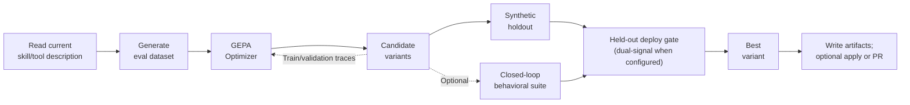

# 🧬 Agent Self-Evolution

[](https://github.com/azalith-9/agent-self-evolution/actions/workflows/tests.yml)

**Automated evolution for the skills, prompts, and tool code your agent runs on.**

Agent Self-Evolution proposes changes to the artifacts your agent depends on — skills, tool descriptions, system-prompt sections, tool implementations — and accepts candidates that pass the target-specific gate. Skills and tools use held-out judge scores, with optional real-agent validation; prompt sections use behavioral validation, and code repairs use executable tests. These checks reduce regression risk within the evaluated tasks; they cannot guarantee regression-free deployment. No GPU training is required. Cost depends on the models, dataset, budget, and agent repetitions; real-agent validation can dominate spend.

**Works on any agent framework that emits `SKILL.md` files** — [Hermes Agent](https://github.com/NousResearch/hermes-agent) is the original target; Claude Code and any other `<dir>/<skill>/SKILL.md` layout are supported via a pluggable skill-source abstraction.

## How It Works



This diagram covers skill and tool-description evolution. Prompt sections use behavioral fitness and a behavioral gate; tool code uses iterative test-feedback repair. GEPA reads execution traces to propose targeted improvements ([paper](https://arxiv.org/abs/2507.19457)). The framework adds a **held-out deploy check**, **three-dimensional judge scoring** for skills/tools, and an optional **closed-loop behavioral suite** — the rationale is in [docs/framework_advantages.md](docs/framework_advantages.md). A **saturation pre-flight** can stop a run before search when the baseline lacks usable signal; overrides are available. **Closed-loop validation** runs the real agent on a task suite to measure behavioral changes (both in the [usage guide](docs/usage.md)).

## Quick Start

```bash
git clone https://github.com/azalith-9/agent-self-evolution.git
cd agent-self-evolution
uv sync
```

Use Linux or macOS with Git, [uv](https://docs.astral.sh/uv/), and Python `>=3.10,<3.15`
(CI tests Python 3.10–3.14). The lockfile pins DSPy 3.4.1, LiteLLM 1.82.6,
and GEPA 0.1.4; the framework explicitly selects DSPy's LiteLLM engine.
Install `uv sync --extra miprov2` to enable
the fallback optimizer. See [dependency constraints](docs/dependencies.md)
for the provider compatibility and upgrade boundaries.

**Contained execution.** Repairs and real-agent
validation require a backend that verifies the requested filesystem, network, and
process-cleanup capabilities before repository code runs. Linux uses Bubblewrap;
macOS requires an OS policy covering the full process tree. An installed sandbox
binary alone is insufficient. Prepare build/test dependencies separately for
offline repository execution. See [run repairs with contained execution](docs/howto/run-contained-repairs.md)
for prerequisites, configuration and refusal handling. Required guarantees must be established on the execution host; platform labels and mock
tests do not supply native evidence.

**Evolve an installed skill with Hermes Agent.** Provider/model defaults come from `~/.hermes/config.yaml`, credentials from `~/.hermes/auth.json` or provider environment variables. Skills are discovered under `~/.hermes/hermes-agent/skills/`; set `SKILL_SOURCES_HERMES_REPO` if your checkout is elsewhere. Replace the example skill name with one you have installed.

```bash
uv run python -m evolution.skills.evolve_skill --skill github-code-review --budget light
```

**Evolve a local skill with a supported provider.** For a skill at `./skills/my-skill/SKILL.md`, set provider credentials and pass its source directory. Explicit model flags override Hermes defaults; reflection follows the optimizer model. Claude Code plugin-cache skills are also auto-discovered.

```bash
export ANTHROPIC_API_KEY=sk-ant-...
uv run python -m evolution.skills.evolve_skill \
    --skill my-skill --skill-source-dir ./skills --budget light \
    --optimizer-model anthropic/claude-opus-4-5 --eval-model anthropic/claude-opus-4-5
```

**Evolve a Claude Code `CLAUDE.md` convention.** The bundled convention suite scores wrapper-command adherence without an LLM judge. Install the `claude` CLI and obtain `CLAUDE_CODE_OAUTH_TOKEN` from `claude setup-token`, plus provider credentials for GEPA reflection. Under the execution contract, both Claude and Hermes validation require a capable containment backend on Linux or macOS and refuse unavailable required capabilities. A validation agent receives only its selected provider credential and explicitly authorized network policy; subsequent test commands receive neither credential nor network access.

Add a non-empty, named region to your `CLAUDE.md` before running:

```markdown
<!-- evolve:REPO_CONVENTIONS start -->
Prefer repository-provided wrappers when available.
<!-- evolve:REPO_CONVENTIONS end -->
```

```bash
uv run python -m evolution.prompts.evolve_prompt_section \
    --target claude --section REPO_CONVENTIONS --claude-md ./CLAUDE.md \
    --tasks evolution/validation/suites/claude_conventions.jsonl --agent-model sonnet
```

Add `--apply` to write a passing candidate into `CLAUDE.md`; otherwise the run writes proposal artifacts. The bundled suite uses synthetic fixture repositories; supply your own task suite to evaluate your project's conventions.

Full usage guide for every target (tools, prompts, session-history evals, tuning, shipping) → **[docs/usage.md](docs/usage.md)** · all CLI flags → **[docs/interfaces.md](docs/interfaces.md)** · or run `--help` on any command.

## What You Can Evolve

| Phase | Target | Engine | Status |
|-------|--------|--------|--------|
| **Phase 1** | Skill files (`SKILL.md`) | DSPy + GEPA | ✅ [Mechanism validated](reports/phase1_validation_report.pdf) |
| **Phase 2** | Tool descriptions + dual-signal deploy gate | DSPy + GEPA | ✅ [Mechanism validated](reports/phase2_validation_report.pdf) |
| **Phase 3** | System prompt sections (Hermes + Claude Code) | DSPy + GEPA | ✅ [Mechanism validated](reports/phase3_validation_report.pdf) |
| **Phase 4** | Tool implementation code | Iterative test-feedback repair | ✅ [Validated](reports/phase4_validation_report.pdf) |
| **Phase 5** | Continuous improvement loop | Propose-only triage sentinel | ✅ [Sentinel shipped](reports/phase5_validation_report.pdf) |

Phases 1–3 are validated as a working *mechanism* (the pipeline runs end-to-end and the gate catches regressions); on a *capable* agent, evolving these artifacts mostly catches regressions rather than finding improvements — see [Findings](#findings) for where evolution actually pays off.

## Run Phases Together

Sequence the per-phase evolvers from one run-spec instead of invoking each by hand. The orchestrator runs phases in the order listed in the spec, isolates each as a subprocess, and writes a JSONL run history + summary to its run root. PR creation requires both a phase's top-level `create_pr: true` and `--allow-pr`. To keep runs **propose-only**, also omit `apply` from phase arguments: the PR switch does not prevent in-place application.

```bash
# Resolve the template without spending (does not validate target files):
uv run python -m evolution.orchestrator --spec examples/orchestrator/sample_run.yaml --dry-run

# Copy the template, then edit run.yaml for your installed targets and data:
cp examples/orchestrator/sample_run.yaml run.yaml
# After editing — continue-on-error by default; --only restricts to a subset:
uv run python -m evolution.orchestrator --spec run.yaml --only skills --only tools
```

The [sample run-spec](examples/orchestrator/sample_run.yaml) is a template: its manifest, task, test, and repository paths need replacing before a real run.
Each phase keeps its artifacts under `phases/<spec-index>/<phase>-<target>/`, so
repeated targets with different settings retain separate results. The index is
zero-based, padded to four digits, and remains the same when using `--only` or
`--resume`.

## Use the Gate Without Evolution

The gate is useful whether or not GEPA generated the candidate. Bring your own change and ask whether it's real — none of these run evolutionary search:

```bash
# "Did my hand-written tool-description change actually help the real agent?"
# Requires an installed Hermes CLI and your suite + baseline/evolved tool modules.
# --noise-aware-gate loads a precomputed suite.jsonl.noise.json A/A sidecar;
# it does not calibrate one. Missing/degenerate sidecars use zero tolerance.
uv run python -m evolution.validation.closed_loop --tool patch --hermes-repo ~/.hermes/hermes-agent \
    --tasks suite.jsonl --baseline baseline.py --evolved my_change.py --noise-aware-gate

# "What real bugs in this repo's git stream could the loop fix?" ($0, pure git, no LLM)
uv run python -m evolution.monitor --repo ~/.hermes/hermes-agent
```

**Repair with contained diagnostics.** Set
`REPAIR_REPO` to the target Git checkout and the other variables to its tool,
visible-test, and held-out-test paths, relative to that checkout. Prepare its
dependencies first. This invocation requests required containment and local
proposal artifacts; it can spend on proposer inference:

```bash
uv run --no-sync python -m evolution.code.evolve_code \
    --repo "${REPAIR_REPO:?Set the target Git checkout}" \
    --tool "${REPAIR_TOOL:?Set the repository-relative tool path}" \
    --visible-test "${REPAIR_VISIBLE_TEST:?Set the repository-relative visible test path}" \
    --holdout-test "${REPAIR_HOLDOUT_TEST:?Set the repository-relative held-out test path}" \
    --require-sandbox --no-create-pr
```

The default requires verified containment for setup, imports, tests, and
benchmarks. Missing capabilities cause refusal before repository code executes.
`--allow-unconfined` is diagnostic only and cannot supply deployment evidence.
See the [contained repair guide](docs/howto/run-contained-repairs.md) for the
execution and evidence requirements.

**Protected code verification [PLANNED — Implementation Pending].** The intended
`python-json-command-v1` adapter will verify
reviewed cases for one regular UTF-8 Python file with an independently
provisioned standard-library runtime. Supply `--semantic-spec`,
`--verification-runtime-config` and `--runtime-id` together. `--export-to` binds
an existing local destination during preparation; single-use live authority
installs retained exact bytes and ordinary mode. Packages, arbitrary pytest
certification and publication are unsupported. Cooperative pytest remains
diagnostic. Protected setup and retained-byte prerequisite replay currently
refuse; effective resource controls and continuous runtime/path protection remain
implementation blockers. Provisioning a host alone cannot enable acceptance or
export. The following describes the intended interface, not an available
protected accepting path.

The [credential-free tutorial](docs/tutorials/verify-json-command.md) covers
protocol checks and planned production acceptance, rejection, export and replay
evidence. The production demonstrations remain blocked by the implementation gaps.
The version `"2"` collector distinguishes observed failures from capability gaps;
refusal is not native acceptance. [Verification evidence](docs/protected_verification.md#evidence-boundary)
separates mock behavior, patch applicability and demonstrated native enforcement.
Linux receipts cannot establish macOS behavior.

**Campaign recovery [PLANNED — Implementation Pending].** The intended contract
reuses committed seeds, restores cumulative costs across Hermes and SWE-bench,
and reconciles every billable dispatch, including preparation, retries and late
callbacks. Scoped recovery and durable callback attribution exist; complete
billing coverage, SWE-bench residual-ledger integration and actual immutable
execution identity verification remain unresolved. Unknown cost coverage blocks
subsequent finite-budget dispatch. Identity declarations do not establish what
actually executes, and host provisioning cannot close these implementation gaps.
The planned version `"3"` journal adds decimal-string money and durable dispatch/
reconciliation records; existing version `"2"` history keeps its numeric meaning
and is not silently migrated. See [campaign recovery](docs/campaign_recovery.md).
A scheduling ceiling can be overshot by in-flight calls and is not a provider-side
billing cap.

The [partial findings synthesis](.review/implementation-20261109/FINDINGS.md)
preserves the evidence limits and unresolved obligations. The
[findings location amendment](docs/index.md#findings-artifact-location) replaces
the proposed root `FINDINGS.md` with that retained review artifact; it is not
final implementation acceptance or a completed validation report.

The tool-code gate combines held-out tests, surface freeze, and a baseline-diff regression floor to check single-file repairs. Its evidence is limited to the tests and structural checks actually run.

## Findings

The local campaigns found the clearest behavioral gains where text supplies **a signal the model cannot already infer**. The findings fall into three regimes:

- **GREEN — non-inferable signal (observed).** An operating convention or project wrapper the agent can't guess: a `CLAUDE.md` region drove adherence to a counter-default wrapper from **0% → 100%** held-out (judge-free oracle, n=10); test-feedback code repair reached **12/20 and 34/46 bugs (~60–74%) in the Hermes campaigns**. These are majority-of-three-seeds results on harvested bugs, not a general deployment success rate. The convention report also found that a reasonable instruction already saturated its capable-agent baseline, leaving no demonstrated advantage for evolution over that baseline.
- **NULL — binary-correctness reasoning (a measured cliff).** Two tested substrates bracketed the headroom band from both sides (aced debugging at 1.00; uniformly failed a 13-requirement conjunction at 0.00). Neither produced an intermediate band for testing methodology-skill gains; this does not establish a universal limit on reasoning improvements.
- **FRONTIER — open-ended generative quality (open).** The regime where "a better prompt yields better output" is most plausible (writing, analysis, review) resists measurement: the LLM judge saturates, and an execution oracle needs a *targeted* task while open-ended quality is intrinsically un-targeted ([reports/frontier_quality_findings.md](reports/frontier_quality_findings.md)).

Two consequences worth stating plainly. Evolution earns no magic on its own — on this corpus GEPA is matched by plain best-of-N resampling, and a population-based evolutionary search (the actual [imbue `darwinian_evolver`](https://github.com/imbue-ai/darwinian_evolver)) was tested at equal candidate budget and recovered **6/23 vs best-of-N's 8/23**, recovering nothing best-of-N missed (overlapping confidence intervals; no statistically significant lead). The Hermes code-repair campaigns found traction under a conjunction — an executable oracle, real headroom, and code repair from failing-test feedback (deploy-reachable **~0.60–0.74**, clearing a pre-registered futility floor) — which a leakage check confirms is *test-feedback repair, not autonomous re-derivation*.

An [external SWE-bench Lite campaign](reports/swebench_external_validity_findings.md) reached **23/53 bugs (43%, Wilson 95% CI 31–57%)** across 12 repositories using the same majority-of-three-seeds criterion. This supports transfer of test-feedback repair to the evaluated single-file bugs, while showing that the Hermes 60–74% rate does not transfer wholesale.

Full evidence, CIs, and validity threats: **[headroom experiments](reports/asymmetry_headroom_experiments_findings.md)** · **[consolidated findings](reports/asymmetry_findings.md)** ([PDF](reports/asymmetry_report.pdf)) · **[frontier-quality](reports/frontier_quality_findings.md)** · **[evolver vs best-of-N](reports/darwinian_evolver_evaluation.md)**.

## Engines

| Engine | What it does | Targets | License |
|--------|-------------|---------|---------|
| **[DSPy](https://github.com/stanfordnlp/dspy) + [GEPA](https://github.com/gepa-ai/gepa)** | Reflective prompt evolution from execution traces | skills, tool descriptions, prompt sections | MIT |
| **Iterative test-feedback repair (DSPy)** | Whole-file repair from a failing test in a throwaway worktree, behind the held-out + surface-freeze gate | tool implementation code | MIT |

## Guardrails

Each artifact passes its own deployment checks. Skills and tool descriptions
use static constraints and held-out quality checks; prompt sections use real-agent
behavioral validation. A prompt-section run aborts if either validation arm is
empty or contains abstained tasks, including the compiled-floor probe. Tool-code
repairs must preserve the public surface and pass held-out or oracle checks;
file scope is rechecked after every validation subprocess so modified tests
cannot be reused as evidence.

Closed-loop validation restores its target artifact's bytes and permissions in a
`finally` block and refuses stale backups after interrupted runs. Claude prompt
validation injects candidates through a throwaway append-prompt file; only `--apply`
writes the real `CLAUDE.md`. Repository-wide
tests are a development check (`uv run pytest tests/ -q`); broader candidate
benchmarks can be supplied with `--benchmark-cmd`. Shipping controls and the
human-review boundary are described in the [usage guide](docs/usage.md).

**Execution guardrails.** Repair and validation
execution use explicit read/write roots, private home/cache/temp paths, and fresh
environments. Host credential stores and control sockets remain inaccessible.
Repository setup, imports, tests, and benchmarks run offline without credentials;
validation agents receive only separately authorized provider access. Both Hermes
and Claude require containment of the full process tree. Private home directories
alone do not establish this boundary.

Required capabilities are checked before execution. Bounded cleanup must cover
descendants even after normal exit, timeout, or cancellation. Missing containment,
unknown cleanup, incomplete test evidence, or failed Git scope inspection blocks
authoritative deployment evidence. Diagnostic runs cannot override these
requirements. See [execution safety](docs/concepts/execution-safety.md) and
[execution contracts](docs/reference/execution-contracts.md) for the required
guarantees and the limits of evidence against deliberate forgery.

## Operating the Sentinel

The code-evolution loop has a **propose-only** front-end: a triage sentinel that scans a target repo's recent git stream for repair candidates, ranks them, and writes a queue. Scanning performs no repair. Explicit `--attempt-top` runs test-feedback repair in throwaway worktrees and annotates the queue; it never deploys or opens a PR. A human reviews the results.

```bash
# Scan ($0, pure git, no LLM) — safe to schedule
uv run python -m evolution.monitor --repo /path/to/target-repo --since-days 90

# Attempt the top candidates (the only step that spends; cost-capped, human-gated)
uv run python -m evolution.monitor --repo /path/to/target-repo --attempt-top 3 --max-cost-usd 5.0
```

See **[docs/operating_the_sentinel.md](docs/operating_the_sentinel.md)** for the queue format, the verdict taxonomy, and an opt-in scheduled scan.

## Docs & Reference

- **[docs/usage.md](docs/usage.md)** — worked examples for every target, plus tuning, shipping, and validation
- **[docs/interfaces.md](docs/interfaces.md)** — complete CLI flag reference
- **[Contained repair guide](docs/howto/run-contained-repairs.md)** — execution prerequisites, configuration, and evidence requirements
- **[docs/model_resolution.md](docs/model_resolution.md)** — provider/model resolution, local servers, per-role overrides
- **[docs/framework_advantages.md](docs/framework_advantages.md)** — why the layered gate beats raw DSPy + GEPA
- **[docs/architecture.md](docs/architecture.md)** + **[docs/workflows.md](docs/workflows.md)** — system design and step-by-step traces
- **[PLAN.md](PLAN.md)** — full architecture, eval-data strategy, and phased timeline
- **[reports/](reports/)** — validation reports and findings

## License

MIT — © 2026 [azalith-9](https://github.com/azalith-9) / [jramos](https://github.com/jramos) / [Nous Research](https://github.com/NousResearch)
