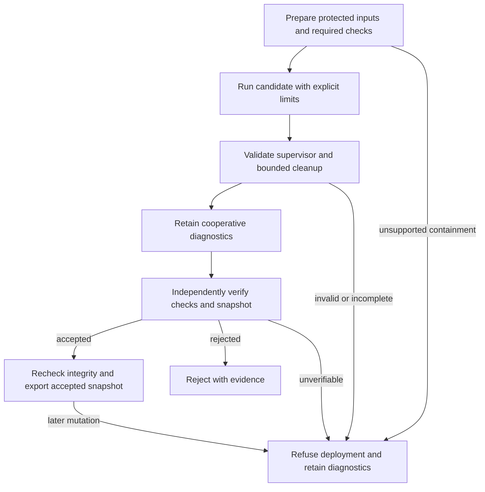

# Execution safety and trustworthy verdicts

Repair candidates execute in disposable environments with explicit filesystem,
environment, network, and process limits. Deployment requires independently verified execution, required checks, and a
binding to the exact bytes and modes exported. A complete diagnostic run alone
cannot authorize it.

## Contents

- [Trust boundaries](#trust-boundaries)
- [Containment capabilities](#containment-capabilities)
- [Execution lifetime](#execution-lifetime)
- [Test evidence and deployment](#test-evidence-and-deployment)
- [Tested bytes and export](#tested-bytes-and-export)
- [Authentication recovery](#authentication-recovery)
- [Validation state](#validation-state)

## Trust boundaries

Trusted orchestration chooses the command, approved inputs, write roots, selected
credential, and execution policy. Candidate code, fixtures, inherited environment
variables, and cached results cannot widen that policy.

Repository-controlled code includes build backends, package initializers, pytest
plugins, benchmarks, agent tools, and executable Git hooks or filters. Setup and
import probes receive the same protections as tests. A private `HOME` alone does
not prevent access to the real home directory; filesystem read restrictions are
also required.

Dependency retrieval is a separate, explicitly networked preparation operation.
Repository builds and editable installation use prepared dependencies offline.
Missing prerequisites cause a preparation failure rather than a retry with wider
network or filesystem access.

Parent-side Git administration uses checked commands outside the candidate's
writable scope. The candidate cannot write the shared Git directory, index, or
worktree registrations. Git behavior that can execute repository code is either
disabled for administrative inspection or executed under the repository policy.

## Containment capabilities

Linux uses Bubblewrap to construct a restricted filesystem and isolated execution
scope. It exposes approved runtime files and input roots rather than binding the
host filesystem wholesale. Private home, cache, temporary, and output directories
receive the necessary write access. Offline execution has no external network
access or host control sockets.

The macOS adapter uses an OS policy around the entire process tree, including
native agent Write/Edit tools. The Claude Code `sandbox` setting does not supply
this boundary. A write-only profile cannot establish confidential-read isolation.
Each requested capability must pass the backend's checks before it is claimed.

An installed binary or successful no-op probe is insufficient evidence. Capability
checks exercise allowed writes, denied writes and reads, network denial when
required, and descendant cleanup. Unsupported capabilities cause refusal.

Bubblewrap network isolation supplies an offline boundary, not a destination
allowlist. A request for access to selected hosts needs a mechanism that enforces
that restriction. The framework refuses an unsupported restricted-network policy;
it never interprets it as unrestricted access.

## Execution lifetime

Every execution has finite runtime and cleanup budgets. Output goes to private
files so descendants retaining stdout or stderr cannot hold `communicate()` open
indefinitely. Only redacted diagnostics are promoted to durable artifacts.

Cleanup covers the execution scope after normal exit, failure, timeout, launch
failure, and cancellation. Killing only the wrapper or its process group is
insufficient when descendants can start new sessions. A backend must establish
execution-wide cleanup or refuse the corresponding guarantee.

The gate waits for bounded cleanup before inspecting artifacts. Failed or unknown
cleanup invalidates deployment evidence even when the direct child exited zero.
`KeyboardInterrupt` and `SystemExit` propagate after cleanup.

## Test evidence and deployment

**Protected path [PLANNED — Implementation Pending].** The accepting/export
flow below describes the intended trust boundary. Protected setup and
retained-byte prerequisite replay still refuse; host provisioning alone cannot
close the implementation gaps. See [verification blockers](../protected_verification.md).

Candidate code and its pytest interpreter are one trust domain. Fixtures, plugins,
collection hooks, and the candidate can alter assertions or fabricate reports.
Even a complete, correctly bound plugin report establishes only cooperative
execution diagnostics. Moving that report into another process, adding a nonce,
or hashing it does not establish independent semantic verification.

Both code gates coordinate assessment through `code.gate.finalize_verification`.
The compatibility `code.deployment_evidence.verify_deployment` helper stays
refusal-only, even when passed its inert optional keyword. Protected
parent orchestration must independently establish required checks, trusted inputs,
invocation and executable identity, containment, cleanup, scope, surface, and
snapshot identity. The verifier accepts behavioral evidence only when its
assertions and interpretation operate beyond candidate control. Constructing a
verification object or setting `TestRun.authoritative` supplies no authority.

The verifier distinguishes accepted proof, a demonstrated violation, and missing
proof. When independent semantic proof is unavailable, it reports
`independent_test_verification_unavailable` and deployment is refused. The
[verifier](../protected_verification.md) obtains independent observations
for reviewed JSON-command cases; selecting it does not promote cooperative
pytest records into proof. Diagnostic repair and campaign results remain useful
when semantic authorization is unavailable. See the
[verification reference](../reference/deployment-evidence.md).

Regression subtraction uses complete, comparable baseline and candidate runs
with matching reviewed checks and trusted inputs. Missing, skipped, deselected,
replaced, or unexecuted required checks cannot qualify. New files require a
complete green execution. Collection errors and partial known failures cannot
pass an oracle comparison.

Diagnostic validation retains ties and abstentions. A diagnostic `pass` describes
the comparison rule over available observations. Prompt deployment separately
requires nonempty baseline and evolved reports without abstentions, including
the compiled-floor path. See [validation state](../reference/execution-contracts.md#validation-and-persistence).

## Tested bytes and export

Protected snapshots and their live
gate-to-export ownership are specified in the
[verification reference](../protected_verification.md#gate-to-export-ownership).

The parent captures candidate bytes and
modes together with the baseline,
trusted inputs, required checks, and invocation identity. Certification runs
against protected source, tests, configuration, and runtime; writable scratch
is separate. A writable parent directory cannot grant access to protected
children. Before/after hashes detect drift but cannot defeat a write-and-restore
attack during execution.

Scope and surface checks refer to that same snapshot. Later subprocesses,
including setup, imports, tests and benchmarks, revoke authority before dispatch
and require fresh assessment. An accepted assessment without a bound export
root has no authority. Prior writable checks cannot certify subsequently
captured bytes; applicable prerequisites run against the retained read-only target.
Export consumes the accepted stored snapshot, verifies final integrity without
a concurrent mutation window, and checks destination bytes and mode. An earlier
proposer string, matching filename, or fresh read from mutable source cannot
substitute for the accepted payload.

## Authentication recovery

An authentication failure belongs to an opaque credential identity and its
generation. Recovery authorizes only the matching retried inference to bypass
that pending condition. A successful retry clears only that recovered condition.
Token refresh alone does not establish recovery.

Sync and async inference use the same attribution rules with isolated recovery
contexts. Another credential's failure, a newer failure generation, and a cost
ceiling remain active throughout recovery. Subsequent calls proceed after a
successful recovery with callbacks registered.

## Validation state

Artifact checksums are verified before each task, including reuse of an installed
candidate or a cached verdict. Prompt offsets and replacement bytes come from
one snapshot. Backup inspection happens while holding the validation lock, and
restoration preserves original content and modes.

Feedback history updates are synchronized without recursively acquiring a
non-reentrant lock. Aborted runs retain decisions and partial progress. Monitor
queues are persisted incrementally; campaign recovery tolerates only an
identifiable torn final record and surfaces corruption elsewhere.

See [execution contracts](../reference/execution-contracts.md) for adapter
obligations and [contained repair operation](../howto/run-contained-repairs.md)
for configuration and refusal handling.
