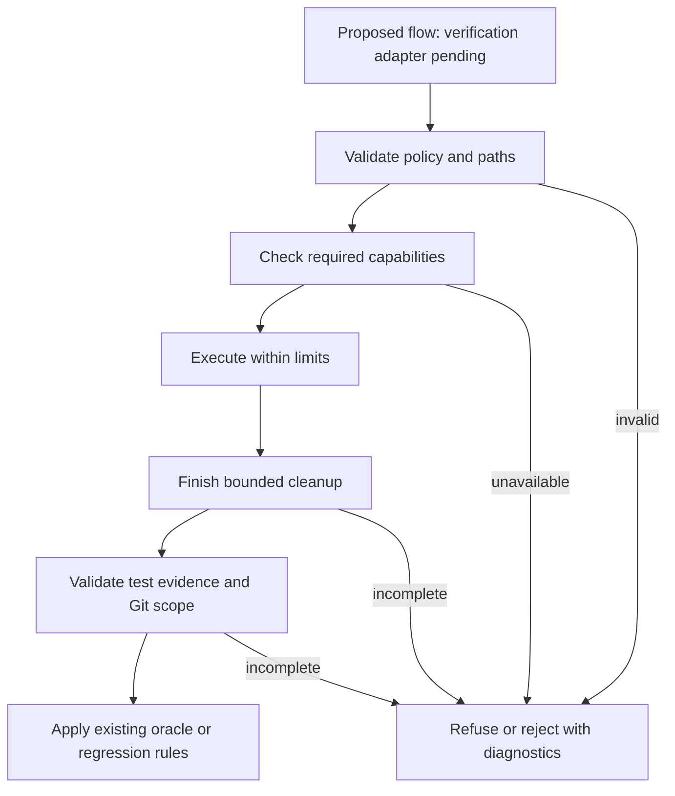

# Execution safety and trustworthy verdicts

**[PLANNED - Implementation Pending]** This explanation describes the intended
execution safety model. Requirements below must not be read as verified behavior
of the recovered implementation. Its environment still inherits `PATH`, and its
gate lacks several deployment-evidence checks. See the source-inspected
[implementation boundary](../reference/execution-contracts.md#implementation-boundary).

Under this model, repair candidates execute in disposable environments with
explicit filesystem, environment, network, and process limits. A deployment
verdict requires evidence that these limits held and the evaluation completed.
Cooperative pytest evidence cannot satisfy this contract; deployment remains
blocked until an independent verifier and its gate checks are implemented.

## Contents

- [Trust boundaries](#trust-boundaries)
- [Containment capabilities](#containment-capabilities)
- [Execution lifetime](#execution-lifetime)
- [Test evidence and deployment](#test-evidence-and-deployment)
- [Authentication recovery](#authentication-recovery)
- [Validation state](#validation-state)

## Trust boundaries

Trusted orchestration chooses the command, approved inputs, write roots, selected
credential, and execution policy. Candidate code, fixtures, inherited environment
variables, and cached results cannot widen that policy.

Preparation snapshots authority without launching a child or discovering a
provider. The trusted parent selects provider fields and credentials before agent
launch. Candidate setup, imports, tests, and benchmarks remain credential-free.
The enforced policy also protects harness code, trusted tests, Git metadata,
selection expectations, capture ownership, and supervisor records from writes
through a granted parent directory.

Repository-controlled code includes build backends, package initializers, pytest
plugins, benchmarks, agent tools, and executable Git hooks or filters. Setup and
import probes receive the same protections as tests. A private `HOME` alone does
not prevent access to the real home directory; filesystem read restrictions are
also required.

Dependency retrieval is a separate, explicitly networked preparation operation.
Repository builds and editable installation use prepared dependencies offline.
Missing prerequisites cause a preparation failure rather than a retry with wider
network or filesystem access.

Parent-side Git administration uses checked commands outside the candidate's
writable scope. The candidate cannot write the shared Git directory, index, or
worktree registrations. Git behavior that can execute repository code is either
disabled for administrative inspection or executed under the repository policy.

## Containment capabilities

Linux uses Bubblewrap to construct a restricted filesystem and isolated execution
scope. It exposes approved runtime files and input roots rather than binding the
host filesystem wholesale. Private home, cache, temporary, and output directories
receive the necessary write access. Offline execution has no external network
access. Host control sockets and shared IPC require their own restrictions;
network isolation alone does not establish either boundary.

The macOS adapter uses an OS policy around the entire process tree, including
native agent Write/Edit tools. The Claude Code `sandbox` setting does not supply
this boundary. A write-only profile cannot establish confidential-read isolation.
Each requested capability must pass the backend's checks before it is claimed.

An installed binary or successful no-op probe is insufficient evidence. Capability
checks exercise allowed writes, denied writes and reads, network denial when
required, and descendant cleanup. Unsupported capabilities cause refusal.

Bubblewrap network isolation supplies an offline boundary, not a destination
allowlist. A request for access to selected hosts needs a mechanism that enforces
that restriction. The framework refuses an unsupported restricted-network policy;
it never interprets it as unrestricted access.

Bubblewrap's network namespace has a private loopback interface. Host loopback
isolation, traffic within that namespace, filesystem sockets, and abstract sockets
are separate policy questions. Required restrictions need targeted native probes
or refusal. Bubblewrap supplies mechanisms; the launch arguments define the
security policy, as its [upstream security documentation](https://github.com/containers/bubblewrap/blob/main/README.md#sandbox-security)
explains. No generic availability check certifies a provider-network policy.

## Execution lifetime

Every execution has finite runtime and cleanup budgets. Output goes to private
files so descendants retaining stdout or stderr cannot hold `communicate()` open
indefinitely. Only redacted diagnostics are promoted to durable artifacts.
Capture size is bounded during execution; overflow ends execution with an
explicit failure and bounded cleanup.

Cleanup covers the execution scope after normal exit, failure, timeout, launch
failure, and cancellation. Killing only the wrapper or its process group is
insufficient when descendants can start new sessions. A backend must establish
execution-wide cleanup or refuse the corresponding guarantee.

The gate waits for bounded cleanup before inspecting artifacts. Failed or unknown
cleanup invalidates deployment evidence even when the direct child exited zero.
`KeyboardInterrupt` and `SystemExit` propagate after cleanup.
Successful execution cannot establish cleanup certification by itself. A platform
without a verified mechanism refuses the required operation or records uncertified
cleanup, which blocks deployment. Native test unavailability is reported separately
from a reproduced implementation defect.

## Test evidence and deployment

The harness combines invocation-bound test evidence, subprocess status,
containment evidence, cleanup status, and checked Git scope inspection. Missing or
contradictory evidence cannot become an empty set of failures.

Regression subtraction compares complete baseline and candidate evaluations of
the same scope. A newly added file requires a complete green execution where no
baseline exists. Collection errors, interruptions, and timeouts remain incomplete
even if they name failures already present in an oracle.

The pytest plugin runs in the candidate interpreter. It detects missing or
inconsistent execution evidence but does not prove integrity against deliberately
malicious code that forges the plugin's records. Such candidates require independent
verification outside that interpreter before deployment authorization. Containment
and an invocation identifier do not make forged scores trustworthy.
If that independence cannot be established, the proposed gate must refuse deployment.
The recovered gate's use of `TestRun.authoritative` does not enforce this boundary.
Parent-owned
payload identities, trusted-test identities, and expected selection also prevent
a complete run of the wrong tests from satisfying the requested evaluation.

The planned eligible path uses protected trusted tests in a separate verifier
that sends data requests to a contained candidate worker and checks its responses.
Candidate code never runs in that verifier. Arbitrary in-process pytest execution
remains diagnostic-only. The [verification mechanism](../reference/execution-contracts.md#independent-verification-and-eligible-execution)
defines the isolation, identity, coverage, and gate requirements; no current
adapter provides this eligible path.

Diagnostic validation retains its tie and abstention semantics. A diagnostic
`pass` means the comparison rule found no regression in available observations;
it does not authorize deployment. `TestRun.authoritative` likewise retains a
diagnostic meaning and cannot grant deployment authority. Prompt deployment requires complete
baseline and candidate reports, including the compiled-floor path. See the
[evidence reference](../reference/execution-contracts.md#validation-and-persistence).

## Authentication recovery

An authentication failure belongs to an opaque credential identity and its
generation. Recovery authorizes only the matching retried inference to bypass
that pending condition. A successful retry clears only that recovered condition.
Token refresh alone does not establish recovery.

Sync and async inference use the same attribution rules with isolated recovery
contexts. Another credential's failure, a newer failure generation, and a cost
ceiling remain active throughout recovery. Subsequent calls proceed after a
successful recovery with callbacks registered.

## Validation state

Artifact checksums are verified before each task, including reuse of an installed
candidate or a cached verdict. Prompt offsets and replacement bytes come from
one snapshot. Backup inspection happens while holding the validation lock, and
restoration preserves original content and modes.

Feedback history updates are synchronized without recursively acquiring a
non-reentrant lock. Aborted runs retain decisions and partial progress. Monitor
queues are persisted incrementally; campaign recovery tolerates only an
identifiable torn final record and surfaces corruption elsewhere.
Persistence failure is reported without masking the original failure or cancellation.

See [execution contracts](../reference/execution-contracts.md) for adapter
obligations and [contained repair operation](../howto/run-contained-repairs.md)
for configuration and refusal handling.
